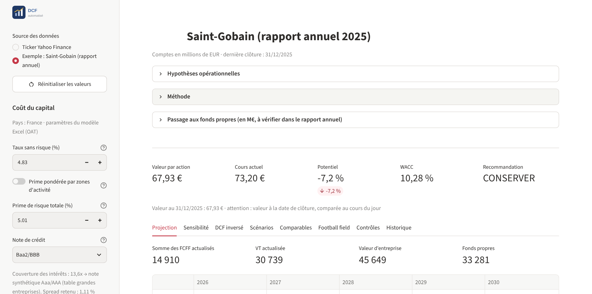
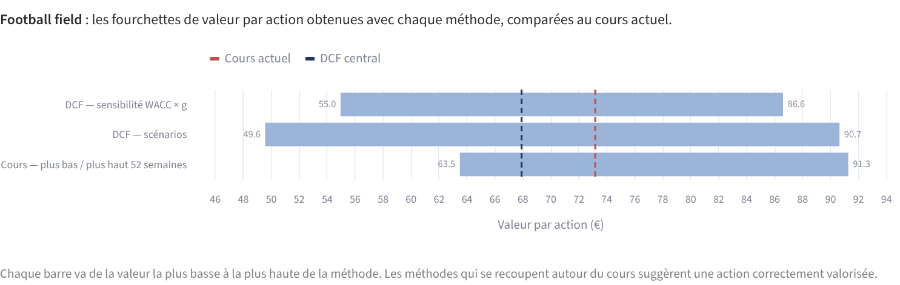
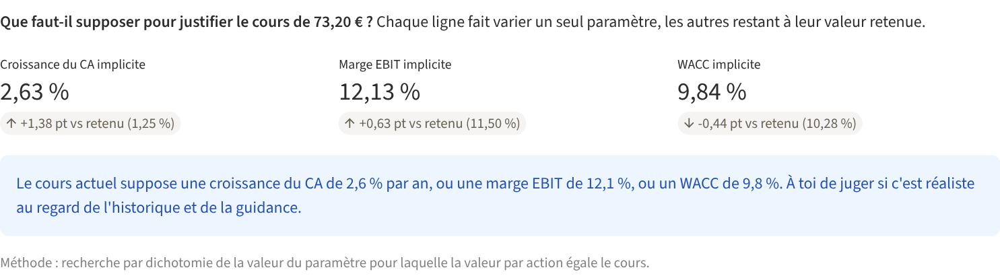

# DCF automatisé — Valorisation d'actions cotées

Outil de valorisation par actualisation des flux de trésorerie disponibles (DCF, méthode FCFF) :
on saisit un ticker, l'application récupère les données, construit le modèle et indique ce que
le cours actuel suppose sur l'avenir de l'entreprise.

**Application en ligne : [dcf-helios-noiry.streamlit.app](https://dcf-helios-noiry.streamlit.app/)**
(si elle est en veille, cliquer sur le bouton de réveil : le démarrage prend une trentaine de secondes).



## Ce que fait l'outil

- **DCF FCFF pour n'importe quelle entreprise cotée** à partir de son ticker Yahoo Finance
  (SGO.PA, ML.PA, AAPL…), avec un horizon explicite et une phase de transition optionnelle.
- **Coût du capital par pays** : taux sans risque de la devise, prime de risque Damodaran du pays
  (ou pondérée par zones d'activité), note de crédit synthétique pour le coût de la dette.
- **Bêta** : régression sur 5 ans contre l'indice du pays, ajustement de Blume, ou bêta sectoriel
  Damodaran réendetté quand la régression n'est pas fiable.
- **Valeur terminale** de Gordon ou formule du ROIC (McKinsey), qui impose de financer la croissance.
- **IFRS 16** : loyers traités comme une dette ou comme une charge, au choix.
- **DCF inversé** : croissance, marge ou WACC implicites dans le cours.
- **Scénarios pondérés**, **sensibilités** WACC × g et croissance × marge.
- **Comparables trouvés automatiquement** (même secteur, même zone, taille proche) et valorisation
  par les multiples VE / EBITDA.
- **Football field** qui confronte les méthodes au cours et à sa fourchette sur 52 semaines.
- **Contrôles de cohérence** (part de la valeur terminale, ROIC implicite, multiple implicite,
  écart au cours…) : la recommandation est bloquée quand les données ne sont pas fiables.
- **Export Excel avec formules** : le classeur se recalcule si l'on modifie une hypothèse.

## Démarche

Le modèle a d'abord été construit à la main dans Excel sur **Saint-Gobain**, à partir du rapport
annuel 2025 : retraitement des comptes, calcul du bêta, WACC, projection des flux, passage aux fonds
propres, sensibilités et scénarios. Il a ensuite été traduit en Python puis automatisé.

Le cas Saint-Gobain sert de référence : en scénario central, sans option, le modèle doit donner
**67,93 € par action** (cours de 73,20 €, potentiel de −7,2 %, recommandation « Conserver »).
Cette valeur est vérifiée par les tests automatiques à chaque modification du code.

## Méthode

- FCFF = NOPAT + D&A − Capex − ΔBFR − loyers IFRS 16, avec NOPAT = EBIT × (1 − t)
- WACC = E / (D + E) × Ke + D / (D + E) × Kd × (1 − t)
- Ke = taux sans risque + bêta × prime de risque ; Kd = taux sans risque + spread de crédit
- Bêta sectoriel réendetté (Hamada) : bêta endetté = bêta désendetté × (1 + (1 − t) × D / E)
- Valeur terminale (Gordon) = FCFF N × (1 + g) / (WACC − g)
- Valeur terminale (ROIC) = NOPAT N × (1 + g) × (1 − g / ROIC) / (WACC − g)
- Valeur des fonds propres = valeur d'entreprise − dette nette − minoritaires − provisions retraites
  − autres dettes + participations ; divisée par le nombre d'actions dilué
- Options : convention de milieu d'année, valorisation à la date du jour (dividendes versés retirés),
  affichage dans une autre devise

## Limites et cas particuliers

Ces limites sont assumées : l'outil propose un point de départ, l'analyste valide les hypothèses.

- **Données Yahoo Finance** : leurs définitions (BFR, D&A, dette) diffèrent parfois du rapport annuel.
  Les montants clés restent modifiables à la main.
- **Banques et assurances exclues** : leur dette est leur matière première, le DCF FCFF n'a pas de sens.
- **Banques captives** (Renault) : détectées, la recommandation est bloquée ; il faut valoriser
  l'activité industrielle seule.
- **Dette incomplète chez Yahoo** (Orange) : détectée par la cohérence avec les charges d'intérêts ;
  la recommandation reste bloquée tant que la dette publiée n'est pas saisie.
- **Bêta de régression peu fiable** (R² faible, valeur extrême) : remplacé par le bêta sectoriel.

## Deux exemples

**Football field** : les fourchettes du DCF (sensibilité et scénarios) se recoupent avec la
fourchette du cours sur 52 semaines.



**DCF inversé** : le cours de 73,20 € suppose une croissance de 2,6 % par an, ou une marge EBIT
de 12,1 %, ou un WACC de 9,8 %, contre 1,25 %, 11,5 % et 10,3 % retenus.



## Installation locale

Python 3.12 ou plus récent.

```bash
git clone https://github.com/heliosnry/dcf-app.git
cd dcf-app
python -m venv .venv
.venv\Scripts\activate            # Windows (macOS / Linux : source .venv/bin/activate)
pip install -r requirements-dev.txt
streamlit run src/app.py          # lance l'application
pytest                            # lance les tests
python src/data.py SGO.PA         # valorisation en ligne de commande
```

## Structure du code

```
src/dcf.py        moteur de calcul (projection, WACC, valeur terminale, DCF inversé, sensibilités)
src/data.py       données Yahoo Finance, ratios, paramètres pays, bêtas, comparables, alertes
src/export.py     export Excel avec formules
src/app.py        interface Streamlit
src/donnees/      tables Damodaran (bêtas sectoriels, primes de risque par pays)
src/assets/       logos
tests/            tests du moteur, des données, de l'export Excel et de l'interface
docs/             captures d'écran
```

## Sources

- Yahoo Finance (via la bibliothèque yfinance) : comptes annuels, cours, comparables
- Aswath Damodaran, NYU Stern, mise à jour de janvier 2026 : bêtas sectoriels, primes de risque
  par pays, spreads par note de crédit
- Taux d'État à 10 ans (novembre 2026)
- Saint-Gobain, rapport annuel 2025 (cas de référence)

## Auteur

Hélios Noiry, étudiant en L2 Économie-Gestion et MIASHS à l'Université Paris Nanterre.

*Projet personnel à visée pédagogique, ne constitue pas un conseil en investissement.*
